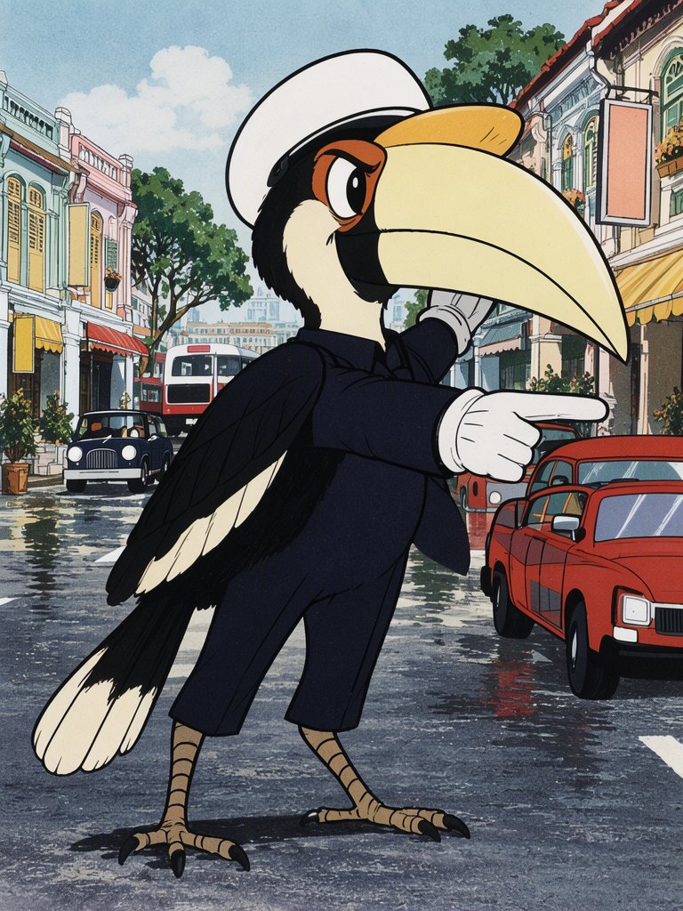
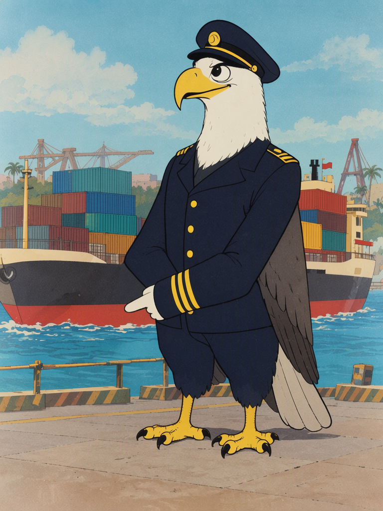

# 上美赛璐璐 · 本地 MOSS-Image

在 8GB 显卡上，用 ComfyUI 原生节点跑开源 [MOSS-Image](https://github.com/OpenMOSS/MOSS-Image)，出上海美术电影制片厂《黑猫警长》那种手绘赛璐璐静帧。

这不是云端 API，不花 Comfy 点数。权重放在本机，图在本机出。仓库里没有模型文件，只有已经在 RTX 5060 Ti 8GB 上跑通的工作流、提示词和四张样图。

Hermes 里的对应 skill 是 `shangmei-moss-image`（`SKILL.md`）。给人看的说明是这份 README。

## 样图

同一套参数，只改场景和种子。768×1024，约 3 分钟一张。

| 样图 | 种子 | 内容 |
| --- | --- | --- |
|  | 1101 | 水獭，白小贩制服，新加坡小贩中心炒粿条 |
|  | 2202 | 东方斑犀鸟，深蓝交警服，店屋街指挥交通 |
|  | 3303 | 长尾猕猴，黄盔橙背心，组屋脚手架 |
|  | 4404 | 白腹海雕，海军领航员制服，集装箱码头 |

招牌上的字是乱的。提示词写了不要文字，模型仍会在背景牌子上涂字。这是这套权重的已知行为，不是工作流接错。

## 这套东西做什么，不做什么

做：

- 本地文生图，上美 1980 年代赛璐璐：墨线、平涂、大眼睛、双足人形动物、画出来的背景。
- 8GB 显存上能放下的量化组合。
- 用 ComfyUI HTTP API 提交，不依赖网页里点 Run。

不做：

- 视频、对口型、配音。MOSS-Image 是图像模型。
- 画面里要出现正确中文或英文。它会画字，但会画错。要正确文字就换任务。
- BF16 全精度。DiT 单文件约 10.2GB，8GB 卡放不下。
- 旧版插件工作流。不要把 `ModelSamplingSD3` 接进原生图。
- 把权重打进这个仓库。权重从 Hugging Face 下，许可证是 Apache-2.0，体积大约 13GB。

## 实测硬件

| 项 | 值 |
| --- | --- |
| 系统 | Windows 11 |
| GPU | NVIDIA GeForce RTX 5060 Ti，8151 MiB |
| ComfyUI | 0.42.5（`comfyui_version.py`） |
| 前端包 | comfyui-frontend-package 1.55.18 |
| 启动 | `python main.py --port 8188 --listen 127.0.0.1 --lowvram` |
| 单张 | 768×1024，20 步，约 170 秒 |

8GB 上不要同时开 Ollama 或其他占满显存的进程。出图时文本编码器放 CPU，扩散模型走 `--lowvram`。

## 版本门槛

MOSS-Image 的原生支持在 2026-10-16 合入 ComfyUI（提交 `e087d8f6`）。官方说明写过：截至 2026-10-19，发布版 `v0.41.3` 还没有这项支持。

本机 `0.42.5` 已经有：

- `comfy/ldm/moss_image`
- `comfy/text_encoders/moss_image.py`
- `comfy_extras/nodes_moss_image.py`
- `CLIPLoader` 的 type 列表里有 `moss_image`

先查这个，再下权重：

```
GET http://127.0.0.1:8188/object_info/CLIPLoader
```

`type` 里没有 `moss_image` 就升级 ComfyUI，不要去装 `custom_nodes/moss-image` 插件来凑。插件工作流和原生权重的 timestep 乘数不一样，混用会错。

Comfy Desktop 的 `installations.json` 可能还写着旧版本号和 `--port 8000`。以 `comfyui_version.py` 和实际监听端口为准。

## 模型文件

来源：[huggingface.co/Comfy-Org/MOSS-Image](https://huggingface.co/Comfy-Org/MOSS-Image)

只下这三份。字节对不上就不要用。

| 文件 | 字节 | 放到 |
| --- | --- | --- |
| `diffusion_models/moss_image_sft_int8_convrot.safetensors` | 5413698958 | `models/diffusion_models/` |
| `text_encoders/qwen3.5_9b_w4a8_gptq.safetensors` | 7343591088 | `models/text_encoders/` |
| `vae/flux2-vae_small.safetensors` | 249521340 | `models/vae/` |

为什么是这三份：

- SFT 比 Base 更适合成图和排版。8GB 用 INT8，不用 BF16。
- 文本编码器是 Qwen3.5-9B。BF16 约 18GB，INT8 约 9.1GB，W4A8 GPTQ 是 7343591088 字节。8GB 卡用 W4A8，并且 `device=cpu`，编码完就卸掉。
- VAE 用 `flux2-vae_small`。原生模型的潜空间是 Flux2。

不要下的：

- `moss_image_sft_bf16.safetensors`（约 10.2GB）
- `qwen3.5_9b_bf16.safetensors`（约 18GB）
- `Ternary-Bonsai-27B-F16.gguf` 这一类 50GB 文件。那是另一个模型，跟出图无关。

Hugging Face 下载示例：

```bash
hf download Comfy-Org/MOSS-Image diffusion_models/moss_image_sft_int8_convrot.safetensors --local-dir .
hf download Comfy-Org/MOSS-Image text_encoders/qwen3.5_9b_w4a8_gptq.safetensors --local-dir .
hf download Comfy-Org/MOSS-Image vae/flux2-vae_small.safetensors --local-dir .
```

下完核对字节，再把文件挪到上表的三个目录。文件名不要改。

## 安装与启动

1. ComfyUI 升到 0.42.5 或更新。
2. 三份权重放进对应目录。
3. 停掉别的占显存进程。
4. 启动：

```bash
python main.py --port 8188 --listen 127.0.0.1 --lowvram
```

完成标准：日志出现 `To see the GUI go to: http://127.0.0.1:8188`。

5. 核对加载器：

```
GET /models/diffusion_models
GET /models/text_encoders
GET /models/vae
```

三个文件名都在列表里，再提交图。

直接用 `main.py` 启动时，图片落在该安装目录的 `output/`，不一定是 Desktop 配置里的 output 目录。以 `/history` 返回的 `subfolder` + `filename` 为准。

## 工作流

文件：[`workflows/moss_shangmei_api.json`](workflows/moss_shangmei_api.json)

节点只有这些，不要加别的：

| 节点 | 作用 | 关键参数 |
| --- | --- | --- |
| `UNETLoader` | 扩散模型 | `weight_dtype=default`。文件本身是 INT8，不要再套一层 fp8 |
| `CLIPLoader` | 文本编码器 | `type=moss_image`，`device=cpu` |
| `VAELoader` | VAE | `flux2-vae_small.safetensors` |
| `CLIPTextEncode` ×2 | 正向、负向 | 共用同一个 CLIP |
| `EmptyFlux2LatentImage` | 空潜空间 | 768×1024，`batch_size=1` |
| `KSampler` | 采样 | 见下表 |
| `VAEDecode` | 解码 | |
| `SaveImage` | 存盘 | |

采样，按这次跑通的值，不要改：

| 参数 | 值 |
| --- | --- |
| 宽 × 高 | 768 × 1024 |
| steps | 20 |
| cfg | 2.5 |
| sampler | `er_sde` |
| scheduler | `simple` |
| denoise | 1.0 |
| shift | 不另接节点。原生 `MOSSImage` 的 `sampling_settings.shift` 已是 5.0 |

官方 Comfy 模板用 1024×1024、25 步、同样的 `er_sde` / `simple` / CFG 2.5。8GB 上验证过的是 768×1024、20 步。没在这张卡上验证过 1024，不要默认往上加。

不要接：

- `ModelSamplingSD3`。那是旧插件工作流的节点。原生权重换了 timestep 乘数。
- `EmptyLatentImage`。通道不对，潜空间是 Flux2。
- `batch_size` 大于 1。8GB 会挤爆。

提交：

```bash
python scripts/submit_moss.py --prompt "一只水獭穿着白小贩制服，在小贩中心炒粿条" --seed 1101 --prefix sg_moss/otter_hawker
```

脚本会加上画风前缀，把 `PROMPT` 换成完整正向，轮询到结束，打印输出文件名。服务没开时会失败，这是预期。

## 提示词

画风前缀固定，场景另写。不要在场景里再写一遍「赛璐璐」「黑猫警长」，前缀已经写了。

正向前缀：

```
A single full-body character illustration in the exact hand-drawn cel style of Shanghai Animation Film Studio's 1984 series Black Cat Sheriff: bold even black ink contours, flat gouache color fills, slight film grain, painted scenic background, 1980s Chinese cartoon proportions, large glossy eyes, bipedal anthropomorphic animal with simple clothing folds, warm clear daylight, blank signs with no writing, no text, no letters, no logo, no watermark, no photo, no 3D, no modern anime.
```

场景要写清：哪一种动物、毛色、衣服、手里的动作、站在什么地方、三分之侧、脚落地、尾巴可见。背景用画出来的物件，不要照片词。

负向固定：

```
nsfw, worst quality, bad anatomy, extra limbs, extra fingers, watermark, jpeg artifact, photorealistic, realistic fur, 3d render, cgi, modern anime, chibi, blurry, text, letters, logo, signature, deformed face, writing, calligraphy
```

四张场景（接在前缀后面）：

1. 种子 1101。A smooth-coated otter with sleek chocolate-brown fur and a cream chest, wearing a white hawker-cook jacket and a small white paper cap, stands at a round steel wok in a Singapore hawker centre. One paw tosses flat rice noodles with a metal spatula, a low orange flame under the wok, red and blue plastic stools, ceiling fans, empty neighboring stalls, painted steam. The otter looks proud and busy, three-quarter view, feet planted, tail visible.
2. 种子 2202。An oriental pied hornbill with black-and-white plumage and a huge pale-yellow casque, wearing a dark navy traffic-police tunic, white gloves and a plain white helmet, stands in the middle of a Singapore shophouse street. One wing is raised to stop cartoon cars, the other points the way. Pastel Peranakan shophouses, a red-and-white bus far behind, rain trees, wet asphalt, painted clouds. The hornbill looks stern and official, three-quarter view, feet planted, tail feathers visible. All shop signs are blank colored boards.
3. 种子 3303。A long-tailed macaque with grey-brown fur, a pink face and a long tail, wearing a yellow hard hat, an orange safety vest over a blue work shirt and brown boots, stands on metal scaffolding against a beige HDB apartment block. It holds a rolled blueprint in one paw and a wrench in the other, looking capable and cheerful. Tropical sky, painted clouds, a few tiny distant workers, concrete corridors, no readable writing on the blueprint, blank paper.
4. 种子 4404。A white-bellied sea eagle with a white head and chest, grey wings and a hooked yellow beak, wearing a navy harbor-pilot jacket with gold buttons and a plain peaked cap, stands on a container quay. One wing points toward a simplified cartoon container ship, stacked colorful containers behind, cranes as painted shapes, tropical sea and sky. The eagle looks calm and in command, three-quarter view, talons planted, wings folded like arms. No writing on containers, solid color blocks only.

## 和官方文档的差别

| 官方说法 | 这里的做法 | 原因 |
| --- | --- | --- |
| 更新到 nightly，用内置加载器 | 0.42.5 已够 | 本机这份已经带 `moss_image` |
| 插件可加载 HF Diffusers 目录 | 不用插件 | 原生加载器已经能读这三份单文件 |
| 模板 1024、25 步 | 768×1024、20 步 | 8GB 上验证过的尺寸 |
| 负向跳过第 22 层 | 这次没开 SLG | 四张样图没接 SkipLayerGuidance，风格已经成立 |
| Gradio / Diffusers 全模型驻留 GPU | 不走这条 | 5B DiT + 9B 文本编码器驻留 GPU 超过 8GB |

## 失败时看什么

| 现象 | 处理 |
| --- | --- |
| 日志有 `No module named 'triton'` | 忽略。那是 INFO。以 `/history` 的 `status_str` 为准 |
| `/prompt` 返回 `node_errors` | 看缺哪个输入。常见是 CLIP type 不是 `moss_image`，或文件名不对 |
| `status_str=error` 且显存不够 | 确认 `--lowvram`、CLIP `device=cpu`、分辨率仍是 768×1024、没有别的进程占卡 |
| 图是照片或 3D | 正向前缀被截掉了。场景不要替换前缀 |
| 招牌乱码 | 已知。不要为这个重跑，除非任务就是正确文字 |
| Desktop 配置写端口 8000，请求打到 8188 失败 | 看进程实际监听的端口，不要信旧的 `installations.json` |

## 仓库里有什么

```
SKILL.md                         Hermes skill，给代理执行用
README.md                        这份说明
workflows/moss_shangmei_api.json 可提交的 API 图，PROMPT 是占位
scripts/submit_moss.py           填提示词、提交、等到结束
examples/                        四张样图
LICENSE                          本仓库文字与脚本：MIT
```

权重、ComfyUI 本体、用户家目录路径都不在仓库里。

## 许可

- 本仓库的说明、skill、脚本：MIT，见 `LICENSE`。
- MOSS-Image 代码与权重：Apache-2.0，见 [OpenMOSS/MOSS-Image](https://github.com/OpenMOSS/MOSS-Image)。
- 样图由本地 MOSS-Image-SFT INT8 生成，提示词在上面。风格指向《黑猫警长》，不是原片截帧。
